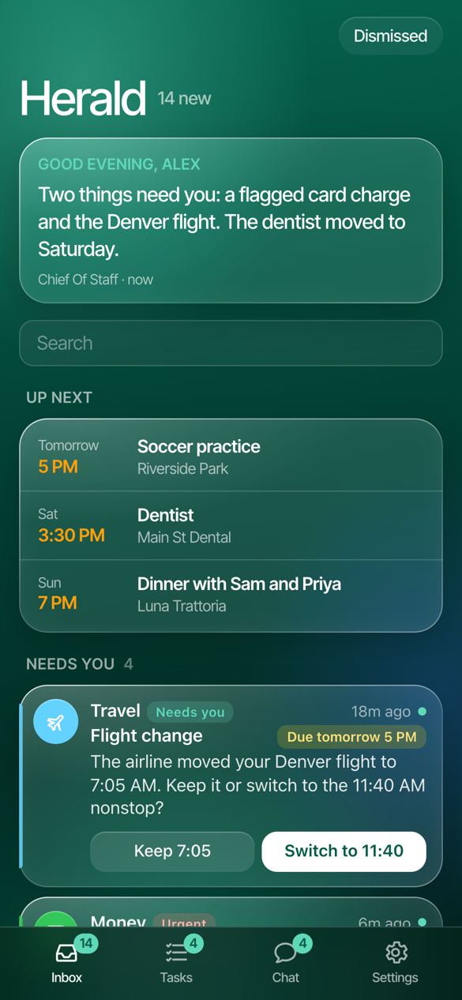
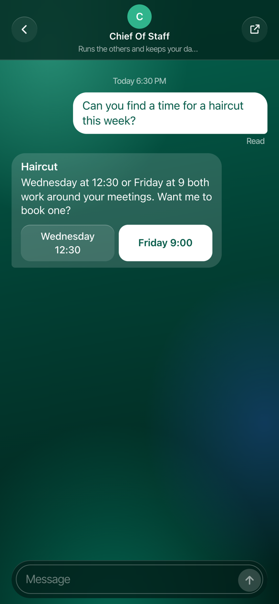
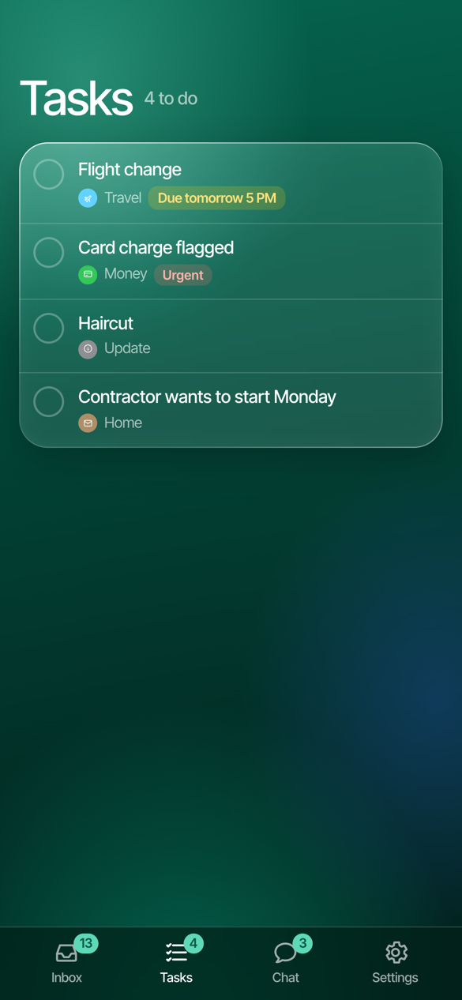
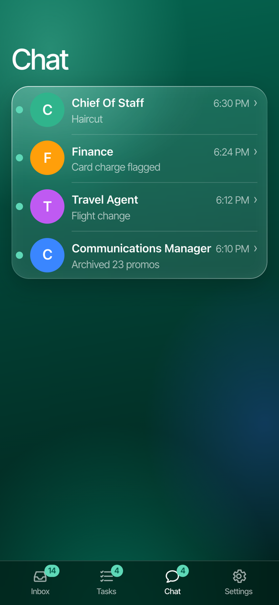

# Herald

A phone app for your Grok Bot. Grok Bot scans your inboxes and calendars, and Herald is where you see and act on what it finds: the few things that need you, everything else stacked by topic, and what it already handled. Swipe to dismiss; swipe harder to archive the email in Gmail too. Snooze, answer, approve and chat with your bots, all from one screen.

Herald is a Progressive Web App you add to your iPhone or Android Home Screen. Each person runs their own copy in their own Cloudflare account, so your cards live in your database and nobody else's.

<table>
  <tr>
    <td></td>
    <td></td>
    <td></td>
    <td></td>
  </tr>
  <tr>
    <td align="center">Home</td>
    <td align="center">Chat</td>
    <td align="center">Tasks</td>
    <td align="center">Your agents</td>
  </tr>
</table>

<sub>Screenshots use made-up data.</sub>

## What you get

- **Home**, top to bottom: a one-line briefing; **Up next** (your next few events); **Needs you** (one card each, soonest due first); **Updates** (everything else, one stack per category, with a summary line from Grok Bot); and **Handled for you** (what Grok Bot already took care of, folded into one line). When an inbox or calendar stops syncing, Home says so, with **Scan now**.
- **Swipes.** Short swipe left: dismiss. Swipe further, past the detent: dismiss and archive the email in Gmail (or trash it, mark it read or unsubscribe, set per category). Short swipe right: snooze it until later today, tonight, tomorrow, the weekend or next week. Swipe further right: done. Undo reverses the Gmail action too.
- **Tasks**: everything that needs you, as a to-do list.
- **Chat**: talk to Grok Bot and its agents like in Messages. Answer their questions with a tap, follow up on any card, and see when your message was delivered and read.
- **Handoffs**: when a step has to happen elsewhere (approving a login in 1Password, signing in inside Grok Bot's chat), the card has a button that goes straight there and shows when it's done. Herald never handles your passwords.
- **Settings**: your categories (Herald owns the list; Grok Bot picks from it and suggests new ones for you to keep, merge or remove), your inboxes and calendars with how often each is scanned, quiet hours, notifications, and how long to keep finished cards.

## Your data

Herald stores your cards in a Cloudflare D1 database in **your** Cloudflare account. That covers what Grok Bot posts (titles, email senders and subjects, snippets, amounts, events), your answers and Chat messages, your settings, and an audit log. It never holds your Google or email passwords and never connects to your mailbox; it asks Grok Bot to act. Only you, signed in with your passkey, and the API keys you issue can read it.

Cards you've answered or dismissed, Chat messages and their logs are deleted for good after 30 days (Settings → Your data: 30 days, 90 days, a year, or keep everything). Cards still in your inbox are never deleted. Your phone keeps a copy of the last inbox so the app opens instantly.

## Set up your own

You need a free [Cloudflare account](https://dash.cloudflare.com/sign-up), [Node.js](https://nodejs.org) 20 or later, and Grok Bot.

```bash
git clone https://github.com/bonorio/herald-for-grokbot.git herald && cd herald
npm install
npm run setup
```

`npm run setup` signs you in to Cloudflare, creates your database, applies the schema, deploys Herald, and prints your Herald address and a one-time setup code. (`npm run setup -- --dry-run` shows what it would do first.) Then:

1. On your phone, open your Herald address in Safari (or Chrome on Android), enter the setup code, and save a passkey.
2. Herald walks you through the rest, one step at a time, and checks each one as you go:
   - your name (optional);
   - adding Herald to your Home Screen (in Safari: the ☰ button left of the address, then Share, then Add to Home Screen);
   - turning on notifications, with a test buzz;
   - **connecting Grok Bot**: copy one message into your Grok Bot chat. It holds no secrets; Grok Bot then asks for Herald's API key and signing secret in its secure secrets box, and you copy each one from Herald. Grok Bot sets up a webhook routine, registers it, and names its main agent and the link to its chat. The step ticks green when it's connected;
   - your inboxes and calendars, which appear as Grok Bot scans them;
   - your categories.

   Skip anything and come back to it from **Finish setting up** on Home.

To sign in on another device, add a passkey from Settings → Passkeys on a device that's already signed in.

## Updating

```bash
git pull
npm install
npm run setup
```

Setup reuses your database and applies any new schema before deploying. Once you have a passkey it skips the setup code and just tells you Herald is updated.

## For Grok Bot

Herald's live instructions for bots are at `/api/agent-guide.md` (read with the API key). They're written from your current setup: what each lane means, your category list, your inboxes' schedules, how to post cards and handoffs, and what to do with every webhook. Grok Bot reads them before posting, so new Herald features reach it without reconfiguring. The full API is described at `/api/openapi.json`.

Herald sends Grok Bot webhooks for what you do:
- answers;
- dismissals, with what to do in Gmail;
- restores, with what to undo;
- snoozes and Chat messages;
- scan requests, and schedule and category changes.

Each one is signed with `X-Herald-Signature: sha256=<hex HMAC-SHA256 of the body>`, using the secret from the connection message.

## How it works

Herald runs on Cloudflare Workers with D1 (SQLite), a Durable Object for live updates and one for rate limits, and a cron that runs every minute.

| Piece | Where |
|---|---|
| REST API, `/api/*` | [src/worker/api.ts](src/worker/api.ts); spec at `/api/openapi.json` |
| Cards, the audit log and outgoing webhooks | [src/worker/notifications.ts](src/worker/notifications.ts), [src/worker/events.ts](src/worker/events.ts) |
| Webhook delivery and the daily tidy-up | [src/worker/outbox.ts](src/worker/outbox.ts) |
| Connecting Grok Bot and signing webhooks | [src/worker/connect.ts](src/worker/connect.ts) |
| Categories, inboxes and calendars | [src/worker/categories.ts](src/worker/categories.ts), [src/worker/sources.ts](src/worker/sources.ts) |
| Instructions for Grok Bot | [src/worker/guide.ts](src/worker/guide.ts) |
| Passkeys, sessions and API keys | [src/worker/auth.ts](src/worker/auth.ts) |
| Push notifications | [src/worker/push.ts](src/worker/push.ts), [src/worker/webpush.ts](src/worker/webpush.ts), [public/sw.js](public/sw.js) |
| Live updates | [src/worker/hub.ts](src/worker/hub.ts) |
| The app | [src/web](src/web) |
| Schema | [migrations](migrations) |

**Writes.** Each change runs in one D1 batch: it updates the card, appends to the audit log, and queues the webhook. A repeated or racing action, such as two dismisses, records one event and sends one webhook.

**Delivery.** Webhooks are sent right after each change, then retried every minute with backoff from 30 seconds up to a day. After 10 failures a delivery is marked failed, and Settings can retry it. Each has a stable `id` (also `X-Herald-Event-Id`) for deduplication. Changes Grok Bot makes with its own key aren't sent back to it.

**Actors and agents.** The signed-in owner is `owner`. Each API key carries its actor: `grok-bot` for Grok Bot, or `service:<name>` for your own services. Grok Bot posts as its agents (each card's `sourceId`). When it connects, it names its main agent, which coordinates the rest; if it has none, it creates one called Chief of Staff. Herald pins the main agent first in Chat. You can pick another in Settings → Grok Bot, or hand the choice back to Grok Bot.

**Lanes and categories.** Every card has a `lane`: `needs_you`, `fyi` or `handled`. Every card has a `category` from the list Herald owns. Bots name a category by id or name. A name Herald doesn't know becomes a suggestion. Renames and merges leave aliases, so old names still land in the right place.

**Push.** New cards from bots buzz every device with notifications on; your own changes don't. During quiet hours only urgent cards buzz, and one "Good morning" push sums up the night. Snoozed cards buzz when they come back. Herald makes its own push keys on first use. On iPhone, push works once Herald is on the Home Screen (iOS 16.4 or later).

**Rate limits.** Sign-in attempts and failed authentication: 10 a minute per IP. API calls: 300 a minute per key.

**Housekeeping.** Once a day Herald deletes finished cards past your retention period, delivered webhooks older than 30 days, and expired sessions.

## Develop

```bash
npm install
cp .dev.vars.example .dev.vars
npm run db:migrate:local
npm run dev                           # http://localhost:5173
bun scripts/seed-local.ts             # sample cards (prints a dev API key)
bun scripts/fake-grok.ts              # optional: logs the webhooks Herald sends
npm test
npm run check
```

Local development and tests use `wrangler.example.jsonc` until `npm run setup` writes your own `wrangler.jsonc`, which stays out of git.
